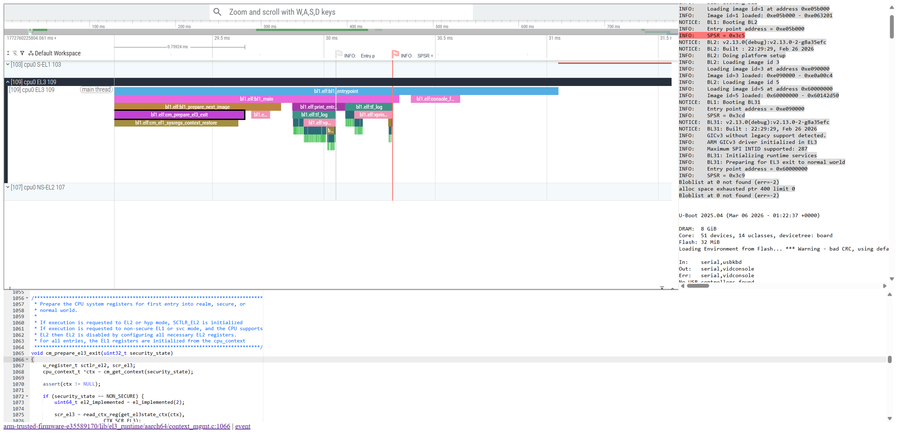

# uftrace-web-viewer

Web view of a uftrace trace, based on Perfetto. It allows you to navigate an
arbitrary long uftrace trace (split in subtraces), showing which functions are
called, and what is the source code associated.



## Requirements

[podman](https://podman.io/) is needed. All dependencies (uftrace,
[chrome2fuchsia](https://github.com/p-b-o/chrome2fuchsia), Perfetto UI, ...)
are defined in `Dockerfile`, and each script runs itself inside a container
built from it. The image is built automatically.

## Example

Recording directly on your machine requires uftrace >= v0.20.

In addition to uftrace trace, you need to produce a timestamped log (using
`ts` from `moreutils`), so that each line can be matched against uftrace trace.

Use `uftrace record` with `--srcline` so that slices can be mapped to source code, and with
`--clock=realtime`, for matching timestamps between log and uftrace.

```
gcc -pg -g -O0 test/nested.c -o program
uftrace record --srcline --clock=realtime ./program |& ts "%.s" | tee exec.log
./uftrace-web-viewer.sh exec.log
```

## uftrace-web-viewer.sh

```
./uftrace-web-viewer.sh [exec_log]
```

Generates static website (using `gen-web.sh`), then serves the result.

See additional options with `--help`.

## perfetto.sh

```
./perfetto.sh from_timestamp to_timestamp out_file_gz
```

Exports a compressed Perfetto trace between two timestamps.
